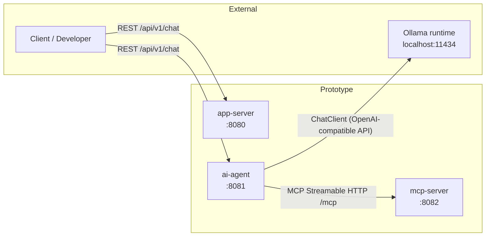
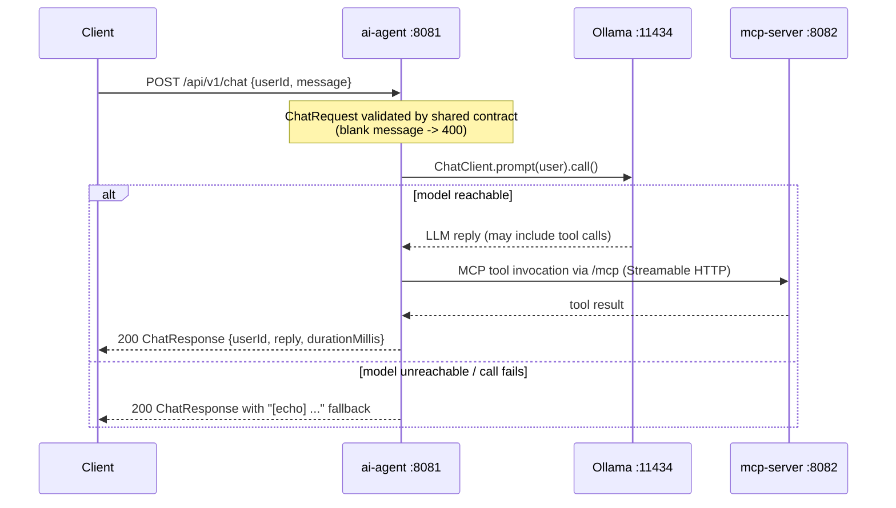
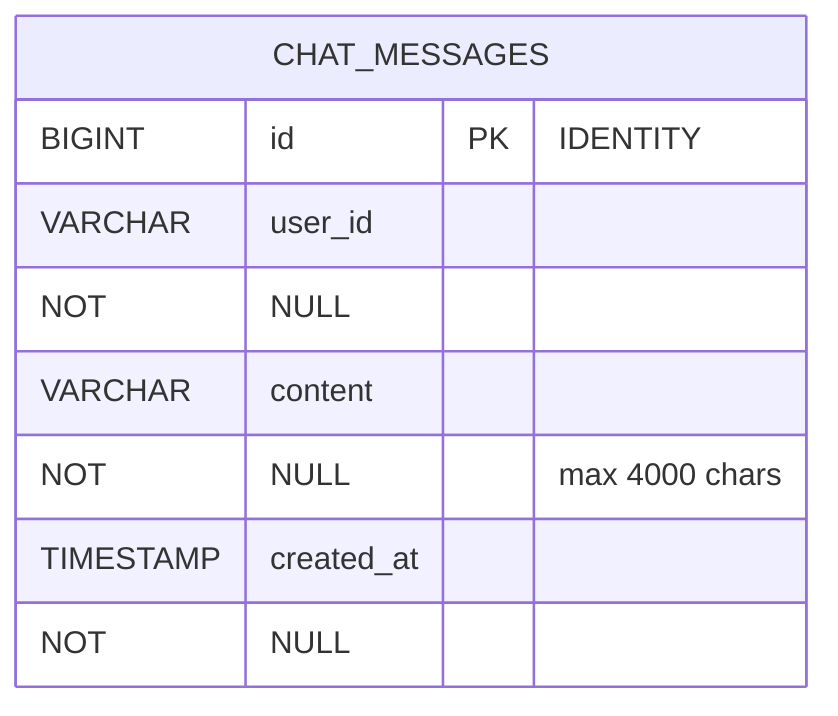
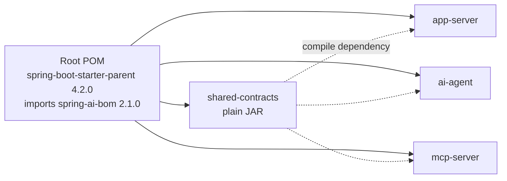
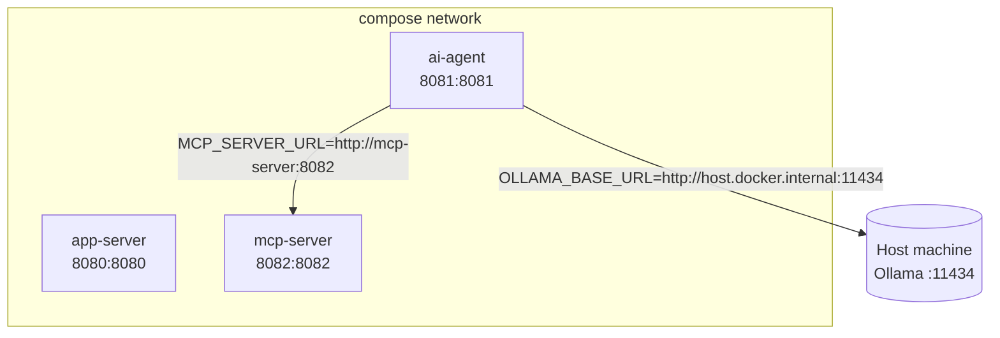

# Design Document — Spring AI Integration Prototype

**Project:** Prototype for an AI integration with a Spring-based application server API
**Status:** As-built design (reflects the current codebase)
**Audience:** Project engineers and architects

> **Living document.** This design describes the system as it exists today. It is
> expected to evolve and change as future requirements are introduced — sections
> marked with forward-looking notes will be revised as those decisions land.

---

## Table of Contents

- [1. Overview](#1-overview)
  - [1.1 Purpose](#11-purpose)
  - [1.2 System Context](#12-system-context)
- [2. Architecture Overview](#2-architecture-overview)
  - [2.1 Module Map](#21-module-map)
  - [2.2 Component Diagram](#22-component-diagram)
  - [2.3 Request Flow](#23-request-flow)
- [3. Shared Contracts](#3-shared-contracts)
  - [3.1 Contents](#31-contents)
  - [3.2 Design Rationale](#32-design-rationale)
- [4. App Server Design](#4-app-server-design)
  - [4.1 Responsibilities](#41-responsibilities)
  - [4.2 API Surface](#42-api-surface)
  - [4.3 Data Model](#43-data-model)
  - [4.4 Persistence Design](#44-persistence-design)
- [5. AI Agent Design](#5-ai-agent-design)
  - [5.1 Responsibilities](#51-responsibilities)
  - [5.2 LLM Integration (Ollama)](#52-llm-integration-ollama)
  - [5.3 Graceful Degradation](#53-graceful-degradation)
  - [5.4 MCP Client Integration](#54-mcp-client-integration)
  - [5.5 API Surface](#55-api-surface)
- [6. MCP Server Design](#6-mcp-server-design)
  - [6.1 Responsibilities](#61-responsibilities)
  - [6.2 Tool Registry](#62-tool-registry)
  - [6.3 Transport and Protocol](#63-transport-and-protocol)
- [7. Build and Deployment Topology](#7-build-and-deployment-topology)
  - [7.1 Maven Reactor](#71-maven-reactor)
  - [7.2 Containerisation](#72-containerisation)
  - [7.3 Compose Network and Startup Ordering](#73-compose-network-and-startup-ordering)
- [8. Key Design Decisions and Trade-offs](#8-key-design-decisions-and-trade-offs)
- [9. Testing Strategy](#9-testing-strategy)
- [10. Future Considerations](#10-future-considerations)

---

## 1. Overview

### 1.1 Purpose

This project is a **prototype for an AI integration with a Spring-based application
server API**. It demonstrates, end to end, how a conventional Spring REST backend can
be extended with:

- a local large language model (LLM) chat capability, and
- a Model Context Protocol (MCP) tool server that the LLM agent can call.

The prototype is intentionally small and self-contained: three deployable services plus
a shared contracts module, all built from one Maven reactor. Its goal is to validate
the architecture, wiring, and operational patterns before those capabilities are
carried into a production application server.

### 1.2 System Context



Key facts about the context:

- **Ollama** is an external dependency of `ai-agent` only. It runs on the host
  machine (or a dedicated container in a pure-container setup) and serves the
  `llama3.2` model by default.
- **No service calls app-server from within the prototype.** The two chat endpoints
  (app-server's persistence endpoint and ai-agent's LLM endpoint) are independent
  surfaces for now; composing them is a future requirement (see
  [Section 10](#10-future-considerations)).

---

## 2. Architecture Overview

### 2.1 Module Map

| Module             | Kind                 | Port | Role                                                        |
|--------------------|----------------------|------|-------------------------------------------------------------|
| `shared-contracts` | Plain Java JAR       | —    | DTOs and enums shared across all services                   |
| `app-server`       | Spring Boot service  | 8080 | REST API + chat message persistence (H2 in-memory)          |
| `ai-agent`         | Spring Boot service  | 8081 | LLM chat via Spring AI ChatClient + MCP client              |
| `mcp-server`       | Spring Boot service  | 8082 | MCP server exposing utility tools over Streamable HTTP      |

Build order in the reactor is fixed: `shared-contracts` first, then the three
services (see [Section 7.1](#71-maven-reactor)).

### 2.2 Component Diagram

```mermaid
flowchart TB
    subgraph app-server :8080
        CC[ChatController<br/>/api/v1/chat]
        CM[(ChatMessage entity)]
        CR[ChatMessageRepository]
        H2[(H2 in-memory DB<br/>chat_messages)]
        CC --> CR --> CM --> H2
    end

    subgraph ai-agent :8081
        AC[AgentController<br/>/api/v1/chat]
        CS[ChatService]
        CHAT[Spring AI ChatClient]
        MCP_C[MCP Client]
        AC --> CS --> CHAT
        CS -.->|fallback on failure| ECHO[Echo fallback]
        CHAT --- OLLAMA[(Ollama<br/>llama3.2)]
        MCP_C --> MSRV
    end

    subgraph mcp-server :8082
        MSRV[MCP endpoint /mcp<br/>Streamable HTTP]
        TOOLS[NippTools<br/>@McpTool beans]
        MSRV --> TOOLS
    end

    SC[shared-contracts JAR] -.->|DTOs: ChatRequest, ChatResponse<br/>ServiceName enum| app-server
    SC -.-> ai-agent
    SC -.-> mcp-server
```

### 2.3 Request Flow

A chat request to the AI agent, with MCP tool availability and the echo fallback path:



Notes on the flow:

- The agent measures wall-clock latency per request and returns it in
  `durationMillis` — useful for comparing local-model performance against
  frontier models later.
- Tool calls are made by the model through the MCP client; the agent itself never
  invokes tools directly.

---

## 3. Shared Contracts

### 3.1 Contents

`shared-contracts` is a plain Java JAR (no Spring Boot, no `spring-boot-maven-plugin`)
containing the wire-level types used across services:

| Type              | Kind    | Purpose                                                                 |
|-------------------|---------|-------------------------------------------------------------------------|
| `ChatRequest`     | record  | `{userId, message}` — shared request body for chat endpoints. The compact constructor rejects blank messages with `IllegalArgumentException`, which Spring maps to HTTP 400. |
| `ChatResponse`    | record  | `{userId, reply, durationMillis}` — shared response body from the agent. |
| `ServiceName`     | enum    | Identifies the three deployable services by wire name (`app-server`, `ai-agent`, `mcp-server`). Used by every `/api/v1/health` endpoint so health responses are self-describing. |

### 3.2 Design Rationale

- **One source of truth for the wire format.** Both chat endpoints accept
  `ChatRequest`; any contract change is made in one place and fails compilation
  everywhere it matters, rather than drifting between services.
- **Validation at the boundary.** The blank-message rule lives in the record itself,
  so every consumer enforces it identically without duplicated guard code.
- **Plain JAR, not a service.** It has no runtime behaviour of its own; keeping it
  free of Spring Boot keeps it trivially consumable by any module and fast to build.
- **Version managed centrally.** The root POM's `dependencyManagement` pins the
  `shared-contracts` version, so consumers declare the dependency without a version.

---

## 4. App Server Design

### 4.1 Responsibilities

The app server is the conventional Spring REST backend:

- Expose a stable `/api/v1` API surface.
- Persist chat messages per user and serve history back in order.
- Provide health and actuator endpoints for operational visibility.

It deliberately has **no AI capability of its own** — LLM concerns are isolated in
the ai-agent so the backend can evolve independently of model choices.

### 4.2 API Surface

| Method | Path                  | Behaviour                                                                 | Success |
|--------|-----------------------|---------------------------------------------------------------------------|---------|
| GET    | `/api/v1/health`      | Returns `{service: "app-server", status: "UP"}`                           | 200     |
| POST   | `/api/v1/chat`        | Persists a `ChatRequest` as a new message; blank/missing `userId` defaults to `"anonymous"` | 201, body is the stored `ChatMessageDto` |
| GET    | `/api/v1/chat/{userId}` | Returns that user's messages oldest-first                              | 200     |

Additionally, Spring Boot Actuator exposes `health`, `info`, and `metrics` web
endpoints, and the H2 console is enabled at `/h2-console` for development inspection.

### 4.3 Data Model



Single table, single entity — the minimal shape needed to demonstrate per-user chat
persistence. `createdAt` is set by the entity constructor (`Instant.now()`), not by
the database, keeping behaviour identical across H2 and any future real database.

### 4.4 Persistence Design

- **H2 in-memory** (`jdbc:h2:mem:appserver`) with `DB_CLOSE_DELAY=-1` so the schema
  survives connection recycling within a JVM; data is lost on restart by design.
- **Hibernate `ddl-auto: update`** generates and evolves the schema from the entity —
  acceptable for a prototype, not for production (see Section 8).
- **`open-in-view: false`** to avoid lazy-loading surprises leaking into controllers.
- Repository is a plain Spring Data JPA interface with one derived query
  (`findByUserIdOrderByCreatedAtAsc`).

---

## 5. AI Agent Design

### 5.1 Responsibilities

The ai-agent is the LLM integration layer:

- Answer chat requests using a local LLM via Spring AI's `ChatClient`.
- Expose MCP tools to the model through the Spring AI MCP client.
- Stay runnable and testable even when no model is reachable (echo fallback).

### 5.2 LLM Integration (Ollama)

The agent uses **Spring AI with the Ollama starter** (`spring-ai-starter-model-ollama`).
Configuration in `application.yml`:

| Property                              | Env var                 | Default                          |
|---------------------------------------|-------------------------|----------------------------------|
| `spring.ai.ollama.base-url`           | `OLLAMA_BASE_URL`       | `http://localhost:11434`         |
| `spring.ai.ollama.chat.options.model` | `OLLAMA_MODEL`          | `llama3.2`                       |
| `spring.ai.ollama.init.pull-model-strategy` | `OLLAMA_PULL_STRATEGY` | `when_missing`                 |

The `ChatClient` bean is built in `AgentConfig` with a fixed system prompt
("You are the AI agent. Be concise and helpful."). The pull strategy controls model
provisioning at startup: `never` (model must already exist), `when_missing` (default,
pull on first use), or `always` (re-pull every start).

> **Decision:** local Ollama models are used for the initial development phase so the
> prototype runs without external API keys, network egress, or cost. Frontier models
> will be introduced during acceptance testing; the Spring AI abstraction means that
> switch is a starter-swap plus configuration, not an architectural change (see
> Section 8).

### 5.3 Graceful Degradation

`ChatService` injects `ObjectProvider<ChatClient>` rather than `ChatClient` directly:

- **No model bean present** → return `[echo] <message>` and log a warning.
- **Model call throws** (e.g., Ollama down mid-run) → catch, log the error, return
  the same echo fallback.

This guarantees the service is always up and always answers, which keeps local
development, CI, and demos robust. The `/api/v1/health` endpoint reports a
`liveModel` boolean so operators can see at a glance whether they are talking to a
real model or the fallback.

### 5.4 MCP Client Integration

The agent depends on `spring-ai-starter-mcp-client`. It connects to the mcp-server's
Streamable HTTP endpoint (default `http://localhost:8082`, overridable via
`MCP_SERVER_URL`) and registers the server's tools with the model. The client can be
disabled entirely with `MCP_CLIENT_ENABLED=false`, which is how tests stay hermetic.

### 5.5 API Surface

| Method | Path             | Behaviour                                                        | Success |
|--------|------------------|------------------------------------------------------------------|---------|
| GET    | `/api/v1/health` | Returns `{service: "ai-agent", status: "UP", liveModel: bool}`   | 200     |
| POST   | `/api/v1/chat`   | Sends the message to the model, returns `ChatResponse` with reply and latency | 200 (echo fallback included) |

---

## 6. MCP Server Design

### 6.1 Responsibilities

The mcp-server is a pure tool provider: it exposes a small set of deterministic
utility tools over the Model Context Protocol so that LLM agents can call them. It
has no chat logic, no state, and no database.

### 6.2 Tool Registry

Tools are declared as `@McpTool`-annotated methods on Spring `@Component` beans
(`NippTools`). The Spring AI annotation scanner picks them up automatically:

| Tool name        | Arguments            | Returns                    | Purpose                          |
|------------------|----------------------|----------------------------|----------------------------------|
| `nipp_echo`      | `text` (required)    | `[echo] <text>`            | Trivial round-trip tool; rejects blank input |
| `nipp_time`      | —                    | ISO-8601 UTC instant       | Current server time              |
| `nipp_word_count`| `text`               | int (0 for blank)          | Word count of the text           |
| `nipp_uppercase` | `text`               | upper-cased string         | Case conversion                  |

The set is intentionally trivial — its purpose is to prove the tool pipeline
(declaration → discovery by the model → invocation → result) works, not to be useful.
Real tools replace these as requirements emerge.

### 6.3 Transport and Protocol

- **Streamable HTTP** on `/mcp` (the default protocol in Spring AI 2.x), synchronous
  server type.
- Server identity: `nipp-mcp-server` v1.0.0.
- A conventional REST health endpoint (`/api/v1/health`) is served alongside the MCP
  endpoint so the service participates in the same operational contract as the other
  two services; Actuator exposes `health` and `info`.

---

## 7. Build and Deployment Topology

### 7.1 Maven Reactor



- **Java 21**, Spring Boot 4.2.0, Spring AI 2.1.0 (BOM imported once at the root so
  no sub-module ever pins its own Spring AI version).
- `mvn clean package` builds all four modules in reactor order; each service produces
  a runnable fat JAR via `spring-boot-maven-plugin`.

### 7.2 Containerisation

Each service has its own **multi-stage Dockerfile** with the repo root as build
context, so CI can build and deploy any single service without rebuilding the others:

1. *Build stage:* Maven compiles the full reactor (parent POM + `shared-contracts`
   are copied in).
2. *Runtime stage:* `eclipse-temurin:21-jre` with only the service's fat JAR.

### 7.3 Compose Network and Startup Ordering



- `ai-agent` declares `depends_on: mcp-server (condition: service_healthy)`, so it
  only starts once the MCP server's TCP healthcheck passes.
- All three services use a lightweight bash `/dev/tcp` healthcheck against their own
  port (5s interval, 12 retries, 20s start period).
- Ollama is **not** part of the compose file: by default the agent reaches it on the
  host via `host.docker.internal`. For a pure-container setup, add an `ollama`
  service and point `OLLAMA_BASE_URL` at it (e.g. `http://ollama:11434`).

---

## 8. Key Design Decisions and Trade-offs

| # | Decision | Rationale | Trade-off / Cost |
|---|----------|-----------|------------------|
| 1 | **Local Ollama models for the initial development phase** (default `llama3.2`) | No API keys, no network egress, no per-token cost; fully reproducible local dev and CI. Frontier models are planned for acceptance testing — Spring AI's provider abstraction makes that a dependency + config change, not a redesign. | Local models are weaker than frontier models; results during development are not representative of final quality. `durationMillis` in every response helps quantify the gap when frontier models arrive. |
| 2 | **H2 in-memory database with `ddl-auto: update`** | Zero-setup persistence that demonstrates the full JPA path; schema evolves automatically from entities. | Data is volatile and schema migration is unmanaged — both acceptable for a prototype, both must be replaced (real DB + managed migrations) before production use. |
| 3 | **Monorepo with one Maven reactor and four modules** | Shared contracts compile-checked against every consumer; one build command; per-service Dockerfiles keep deploy independence. | Single-repo coupling: all services share a release cadence. Acceptable while the team is small and the services evolve together. |
| 4 | **Echo fallback in ai-agent** (`ObjectProvider<ChatClient>`) | The service is always up and always answers, which keeps demos, CI, and local development robust when no model is available. | A 200 response with an echo reply can mask a broken model setup — mitigated by the `liveModel` flag in the health endpoint and warning logs. |
| 5 | **Validation in shared-contract records** (blank message → 400) | One enforcement point, identical behaviour across services, no duplicated guard code. | Contract-level validation is coarse; request-specific rules (e.g., max length) will need per-service handling as requirements grow. |
| 6 | **Trivial MCP tools** (`nipp_echo`, `nipp_time`, …) | Proves the full tool pipeline (declaration, discovery, invocation, result) with zero business logic. | The tools have no real utility; they are scaffolding to be replaced by genuine tools. |
| 7 | **Streamable HTTP MCP transport** | Default in Spring AI 2.x; works over plain HTTP infrastructure, testable with curl/HTTP clients, and container-friendly (no special sockets). | Slightly more moving parts than stdio for local-only use; chosen for networked operation between the agent and a separate service. |

---

## 9. Testing Strategy

All tests are **JUnit 5 + Spring Boot Test** with MockMvc — no live infrastructure
required, so the full suite runs in CI without Ollama, Docker, or network access:

| Module             | Tests (25 total across modules) | Hermeticity technique |
|--------------------|---------------------------------|------------------------|
| `shared-contracts` | Contract records and enum behaviour (validation, factory methods, wire-name mapping) | Pure unit tests |
| `app-server`       | Context load; health endpoint; chat persistence round-trip; anonymous-user defaulting | In-memory H2 per test context |
| `ai-agent`         | Context load; health with `liveModel`; chat returns reply + timing; blank message rejected (400) | MCP client disabled; Ollama pointed at an unreachable port (`127.0.0.1:9`) with pull strategy `never`, so the echo fallback path is exercised deterministically |
| `mcp-server`       | Context load; health endpoint; MCP server wiring | No external dependencies |

The ai-agent test configuration is deliberate: by making the model unreachable, the
suite asserts the degradation contract (the service answers even without a model)
rather than flaking on an absent Ollama install.

---

## 10. Future Considerations

This section tracks known directions that will reshape the design as requirements land;
it is expected to grow and change:

- **Frontier models at acceptance testing.** Swap the Ollama starter for a frontier
  provider (or run both, selected by configuration). The `ChatClient` boundary in
  ai-agent means no other module changes.
- **Composing app-server and ai-agent.** Today the two chat endpoints are
  independent. The natural next step is an orchestrated flow: client → app-server →
  ai-agent (LLM + tools) → persisted reply, with `ChatRequest`/`ChatResponse` already
  in place as the wire format.
- **Real persistence and migrations.** Replace H2-in-memory with a durable database
  and managed schema migrations; drop `ddl-auto: update`.
- **Authentication and tenancy.** The current `userId` is an unauthenticated client
  claim; real identity, per-user isolation, and rate limiting are required before
  external use.
- **Real MCP tools.** Replace the trivial utility tools with tools that expose
  application-server capabilities (e.g., reading chat history) to the model.
- **Operational hardening.** Structured logging, metrics dashboards, and containerised
  Ollama in compose for fully hermetic deployments.
